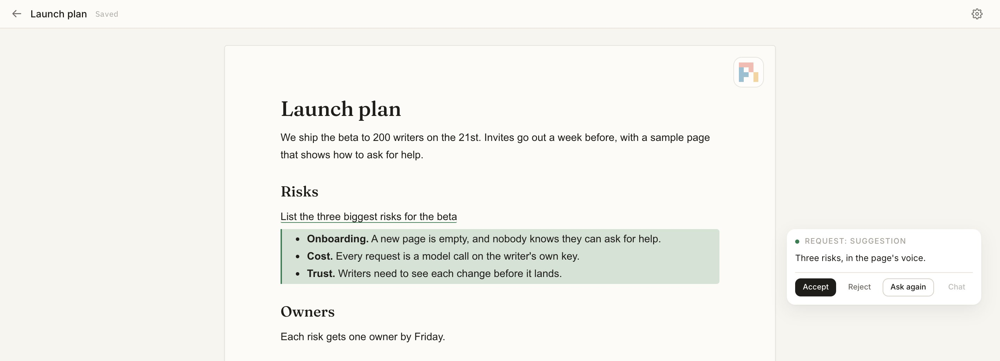

<h1 align="center">
  <picture>
    <source media="(prefers-color-scheme: dark)" srcset="assets/logo/lockup-dark.svg">
    
  </picture>
</h1>

<p align="center">
  A markdown editor for the files in a folder, with agents that suggest and never write the page themselves.
</p>

<p align="center">
  
</p>

<p align="center">
  <a href="https://solipsist.work">Website</a> ·
  <a href="https://solipsist.work/docs/">Docs</a> ·
  <a href="https://solipsist.work/features.html">Every feature</a> ·
  <a href="CONFIGURATION.md">Configuration</a> ·
  <a href="CONTRIBUTING.md">Contributing</a> ·
  <a href="LICENSE">License</a>
</p>

## Run it

You need [Bun](https://bun.sh).

```bash
git clone https://github.com/pulkitsharma07/solipsist ~/solipsist
cd ~/solipsist && bun install
cd ~/my-notes && bun ~/solipsist/src/index.ts
```

Open <http://localhost:3000>. The first launch lists the markdown files in that folder. Pick the ones to work on.

## How your files are kept safe

Solipsist copies the files you pick into `.solipsist/` and you work on the copies. Your files change only when you
press **Sync to file**, and then only in what you changed. If a file changed since you loaded it, Solipsist asks first and offers
**Reload from file**. Comments and agent tasks stay in `.solipsist/`, on your machine.

`git clean -fdx` deletes `.solipsist/`, along with anything not synced yet.

## Finding files in subfolders

By default only the current folder is searched. Add patterns to `solipsist.yaml`:

```yaml
md_search_paths:
  - "*.md"
  - docs/**/*.md
```

Dot-folders, `node_modules` and anything git ignores are never offered. Every setting is in `CONFIGURATION.md`.

## Connect a model

The agents are [Pi](https://github.com/earendil-works/pi), an open-source coding agent, built in: you don't need
to install it. Put `SOLIPSIST_OPENROUTER_KEY` in a `.env` file where you run Solipsist (or in your environment), or,
if you use Pi already, its saved logins, skills and connected tools work here too (`pi`, then `/login`, to add one).

Press `Mod-.` in a page to ask the agent for something at the caret or about the selection.

Like Pi in a terminal, an agent can run commands on your computer. Solipsist doesn't sandbox them.

## Privacy

Solipsist sends nothing about you or your use of it anywhere: no analytics, no telemetry, no update check. Your pages
stay on disk. When you ask an agent for something, the text it needs goes to the model you connect, under that
provider's terms, and to any tools you connected to Pi (a search, a browser, your calendar) if the agent uses them.

## Licence

[FSL-1.1-MIT](LICENSE): use, change and self-host Solipsist for anything except a competing product; each release
becomes MIT two years after it ships. Third-party licences are in `NOTICE`. Questions go to
[Discussions](https://github.com/pulkitsharma07/solipsist/discussions); security reports as in `SECURITY.md`; the
[Code of Conduct](CODE_OF_CONDUCT.md) applies to both.
