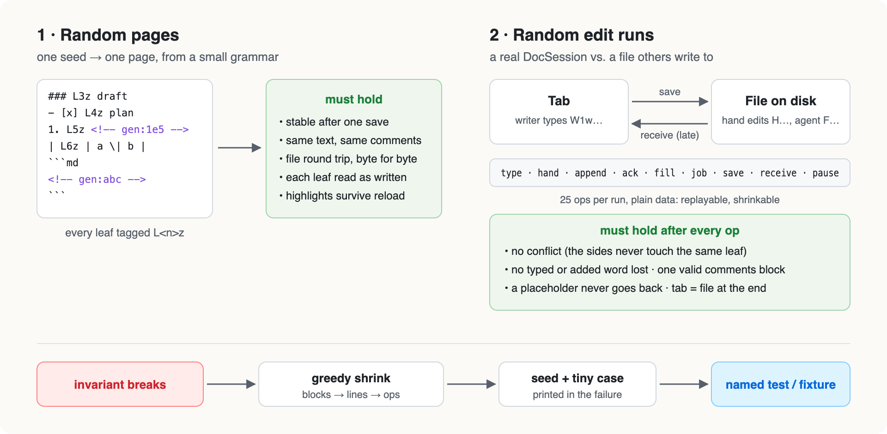
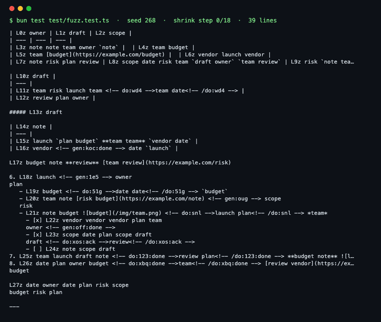
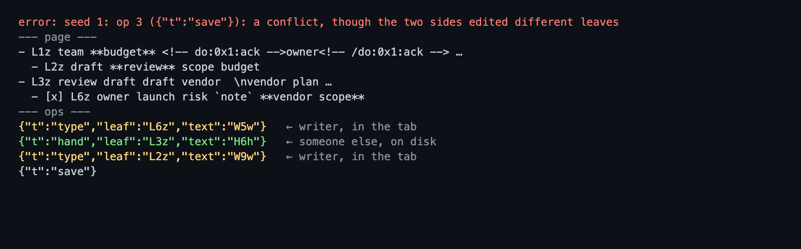

# 500 lines of fuzzing found 7 bugs in an afternoon

*How Solipsist tests a Markdown editor that several writers share with the same file.*

Solipsist is a writing app with one unusual rule: **the page is a plain `.md` file on disk, and nothing else.** There's no database and no hidden JSON. The editor (Tiptap/ProseMirror) loads the Markdown, you type, and it writes Markdown back. Comments live in a hidden HTML block at the bottom of the same file.

That file has more writers than you'd guess:

- you, in the browser tab;
- you again, in vim, because it's just a file;
- an AI agent filling in `<!-- gen:xyz -->` placeholders you left in the text;
- a background job that pins comments to quotes.

Every save is a three-way merge of your tab, the file as it is now, and the base you both started from. Every load turns Markdown into a document tree, and every save turns the tree back into Markdown. If either step loses information even slightly, you don't get an error. You just get a page that quietly changes underneath you.

## Why example tests weren't enough

We already had plenty of hand-written tests: a dialect contract, a folder of fixture pages, and an `everything.md` full of edge cases. They all passed. They also only covered the cases somebody had already thought of.

Markdown's nasty bugs show up where features combine: a task item whose text wraps onto a second line, inside an ordered list indented three spaces, followed by a hard break. Nobody writes that test by hand. A random generator writes thousands of them before lunch.

So we added two property tests. Together they're about 480 lines with no dependencies: [`test/fuzz.test.ts`](../test/fuzz.test.ts), plus a generator, an edit runner and a shrinker in [`test/fuzz/`](../test/fuzz/).



### 1. Random pages

A seeded grammar ([`gen.ts`](../test/fuzz/gen.ts)) builds pages from headings, nested bullet/ordered/task lists, tables with empty cells and escaped pipes, code fences that contain fences, quotes, images, hard breaks, HTML comments, and placeholders in every state. Every generated page has to pass these checks:

- it is **stable after one save**: `save(load(save(load(md))))` equals `save(load(md))`;
- it keeps **the same text and the same HTML comments**;
- it goes through the file format and back **byte for byte**;
- **every block is read as what it was written as**: no list item quietly turns into a paragraph;
- comments the job placed highlight **the same words** in a freshly opened tab.

### 2. Random edit runs

The second test starts from a generated page and plays 25 random operations: the writer types, someone edits the file by hand, the agent acks or fills a placeholder, the job places a comment, a save goes out, a stale update arrives late. The tab is the real `DocSession`, our actual client code running in a fake DOM, not a model of it.

After every operation, these must hold: the file is valid, no placeholder moves backwards through its states, no typed word is lost, and when the run ends the tab and the file agree.

## A few decisions that made it work

**Every leaf carries a name tag.** Each block of text the generator writes starts with a token such as `L17z`. That one trick gives us two things. The checker knows what each leaf was *meant* to be, so "L4z was written as an item, read as a paragraph" is something it can detect. The edit runner can also find the same leaf both in the editor and in the raw Markdown. The `z` is there so `L1` never matches the start of `L12`.

**The two sides never touch the same leaf, so any conflict is a bug.** "Is the merge good?" has no crisp answer. "Did it raise a conflict when the writer and the hand edit changed *different* paragraphs?" does. The runner gives even-numbered leaves to the writer and odd-numbered ones to everyone else. That turns a fuzzy quality question into a yes/no oracle.

**Operations are plain data.** A run is just a list like `{"t":"type","leaf":"L6z","text":"W5w"}`. It can be replayed exactly, and it can be shrunk by deleting entries. Every fifth seed also runs twice, and both runs must end with the same file, which checks that merging is deterministic.

**IDs that YAML wants to eat.** Placeholder ids are three random characters, and 30% of the time they're drawn from `012`, `1e5`, `0x1`, `yes`, `off`, `nul`: the Norway problem, ready to happen in the comments block.

**The shrinker is 26 lines.** It's greedy: drop half the blocks, then a quarter, and so on, then the same with single lines, keeping each cut only if the case still fails. The one subtle part is that the *same kind* of failure must survive. Delete the parent of an indented list item and the item becomes a code block. That's a different story, and chasing it would hand you a minimal repro of the wrong bug.

**Known gaps are skipped explicitly.** Two lists in a row can merge into one. That's a documented gap, so the generator never puts two lists next to each other, with a comment saying why. Fuzzer noise you've learned to ignore is how real failures get ignored too.

**The fuzzer finds bugs. Named tests keep them fixed.** A failure prints its seed and a shrunk case, and that case gets copied into a named test or a fixture file. The fuzzer is free to change its grammar tomorrow without losing a single regression.

Here's the shrinker at work. These are the real shrink steps for seed 268, run against the code from before the fix, going from 39 lines to 2:



## What it caught

All of these were found on the first afternoon, and each fix landed before the fuzzer itself was committed:

**Indent that grew legs.** After a hard break, the parser kept the leading spaces of the next line as text. How many survived depended on the list around it, so every save wrote a different indent (the GIF above). One step further, and a wrapped `    - b` was saved somewhere it read back as a *new list item*.

**Highlighting a comment rewrote your bold.** A comment highlight writes nothing to the file, but it splits the text into pieces, and the serializer closed and reopened marks at each split. So `**budget owner**` came back as `**budget** <strong>owner</strong>`. Raw HTML is plain text in our dialect, so on the next load you'd see literal `<strong>` tags. Worse, the next hand edit *anywhere else* then conflicted with a change the writer never made. Placing a comment was enough to start it.

**Tiptap dropped list items.** Stock `@tiptap/extension-list` silently skipped an ordered item indented differently from the first one: `   1. a` followed by `2. b` lost `b` on the first save. We patch the package now.

**Task items didn't wrap.** `- [ ] a **b` followed by `  c**` became two paragraphs and lost its bold, and the save escaped `**` into literal text. Inside a bullet, an image on a continuation line came back escaped, with one more backslash after every save.

**Phantom merge conflicts.** The tree merge diffs lists of items into hunks, and the diff likes to group neighbouring changes. If the writer edited two adjacent items and a hand edit touched a sibling, the hunks overlapped and you got a conflict banner. Here's seed 1, again replayed against the old code, shrunk to three edits and a save:



The fix splits hunks per item before comparing. The same run also found that an agent filling *two* placeholders in one paragraph conflicted with the writer typing in it.

**A caret in no-man's-land.** When an outside edit turned the paragraph you were in into a list item, the caret ended up mapped *between* two blocks, where ProseMirror can't place a text cursor.

And one it **didn't** catch: a lost save, combined with a 409, could let a hand edit overwrite your typing without showing the conflict banner. The fuzzer's network is polite, since saves always arrive. That one came from the Playwright smoke test in a real browser. Fuzz what your model can express, and test the rest some other way.

## How we run it

```sh
bun test                                # ~200 pages + 25 edit runs, ~10 s, every time
FUZZ_RUNS=16000 bun test test/fuzz.test.ts   # 16,000 pages, 2,000 edit runs, a few minutes
```

The short version runs with every `bun test`. The long one is a rule in our contributor notes: run it after any change to the dialect, the merge or the session. Most of this code is written with an AI agent in the loop, and the long run is the check it can't argue its way past.

When a change touches those parts, its commit message says so. Recording the writer's decisions on suggestions ends with: *"A 16000-run fuzz search passes."*

That's the whole thing: a 130-line grammar, a 150-line edit runner, a 26-line shrinker, and a few invariants simple enough to say in one breath. If your app round-trips a format that humans also edit by hand, write the generator before the next bug report does it for you.
